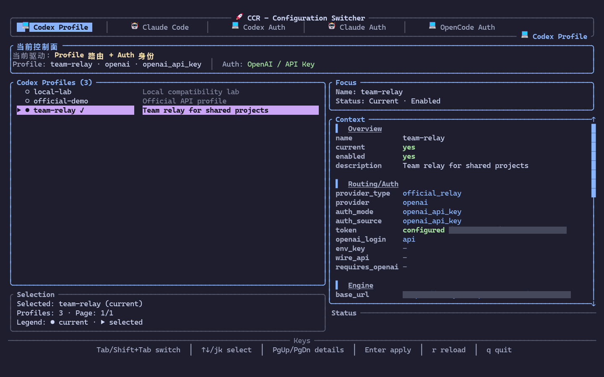
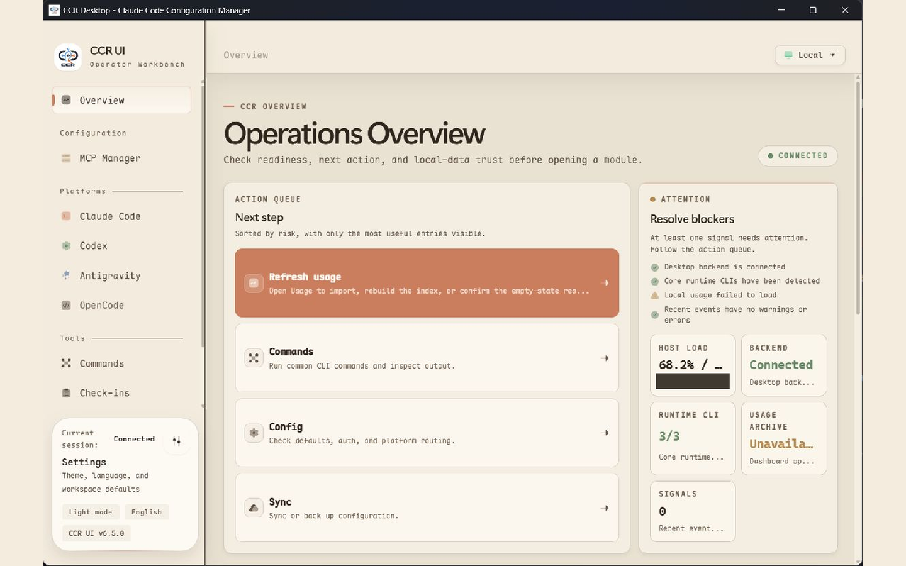
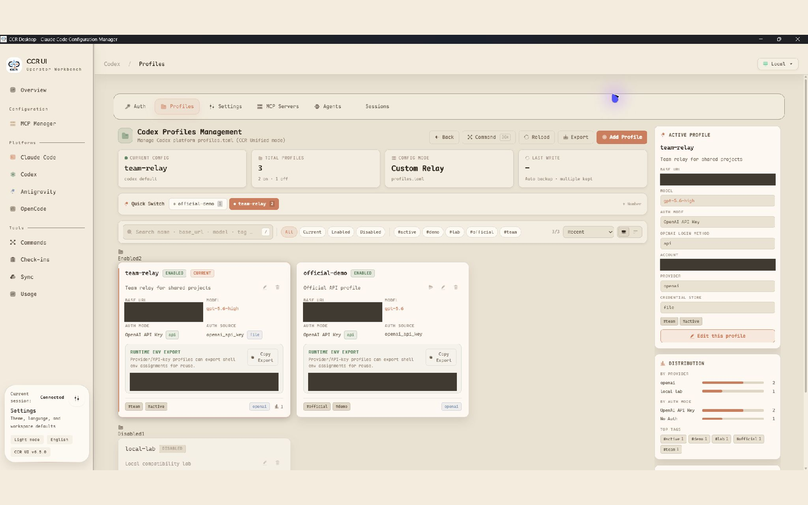

# CCR

**Unified entrypoint for AI CLI configuration and runtime management, written in Rust.**
CLI-first workflow with explicit Claude, Codex, and Grok runtime state backed by SQLite profile catalogs (`profiles.db`), plus TUI and CCR UI.

## ✨ Features

- **Explicit Multi-Runtime Model**: Inspect active runtime and profile routing side by side with `ccr current` (aliases: `ccr status`, `ccr show`).
- **Platform-Scoped Profile & Auth Routing**: Manage live SQLite catalogs (`~/.ccr/platforms/<platform>/profiles.db`) and official accounts explicitly through `ccr <claude|codex|grok> profile ...` and `ccr <claude|codex|grok> auth ...`.
- **Safe Secret Handling & Exchange**: Pipe credentials via `--auth-token-stdin` / `--api-key-stdin` or bind environment variable names with `--env-key`, edit projections in `$EDITOR` via `profile open`, and share sanitized `ExchangeV1` TOML bundles via `profile export --no-secrets` / `profile import`.
- **Enterprise-Grade Safety**: Atomic writes, file locking (`fs4`), masked audit history, and automatic backups.
- **Multi-Interface**: CLI, terminal TUI (`ccr`), and graphical CCR UI (`ccr ui`).
- **Smart Sync & Ecosystem Tools**: WebDAV multi-folder synchronization, unified `ccr doctor` diagnostics, session indexing, and project workflow setup (`ccr project init`).

## Interface Preview

### TUI

The terminal interface keeps profile switching, the active routing/auth context, selected-profile details, and keyboard actions in a single view.



### CCR UI Dashboard

The Dashboard surfaces desktop-backend readiness, the next recommended action, runtime availability, and platform signals before you enter a module.



### CCR UI Codex Profiles

Codex Profiles combines quick switching, search and status filters, profile cards, active-profile context, and configuration distribution in one management view.



## 🚀 Quick Start

```bash
# Initialize platform profile catalog (~/.ccr/platforms/claude/profiles.db)
ccr claude profile init

# Create a profile safely via stdin (never pass plaintext tokens in argv)
printf '%s' "$ANTHROPIC_AUTH_TOKEN" | ccr claude profile create work \
  --base-url https://api.example.com \
  --auth-token-stdin

# Inspect, switch, and verify
ccr claude profile list
ccr claude profile switch work
ccr current
ccr validate
ccr doctor
```

### Canonical Command Map

| Task | Canonical Command |
|---|---|
| Initialize platform catalog | `ccr <claude\|codex\|grok> profile init` |
| Edit catalog in `$VISUAL` / `$EDITOR` | `ccr <claude\|codex\|grok> profile open` |
| Switch / inspect / exit profile mode | `ccr <claude\|codex\|grok> profile switch\|list\|current\|off` |
| Export / import `ExchangeV1` TOML | `ccr <claude\|codex\|grok> profile export\|import` |
| Runtime overview & diagnostics | `ccr current`, `ccr validate`, `ccr doctor`, `ccr platform list` |
| Initialize repository workflow | `ccr project init` |

> Upgrading from an earlier release? See the [Migration Guide](docs/en/reference/migration.md) for the full legacy-to-7.x command and `profiles.db` storage mapping.

## 🔐 Runtime Commands

```bash
# Claude Code
ccr claude profile list
ccr claude profile switch work
ccr claude profile off

# Codex
ccr codex auth current
ccr codex profile list
ccr codex profile switch proxy
ccr codex profile off

# Grok
ccr grok profile init
ccr grok profile create xai --env-key XAI_API_KEY
ccr grok profile switch xai
ccr grok profile off

# Export & import ExchangeV1 TOML
ccr claude profile export --no-secrets -o claude-profiles.toml
ccr claude profile import claude-profiles.toml --dry-run
```

## 🛠️ Development

```bash
just build
just test
just ci
```
