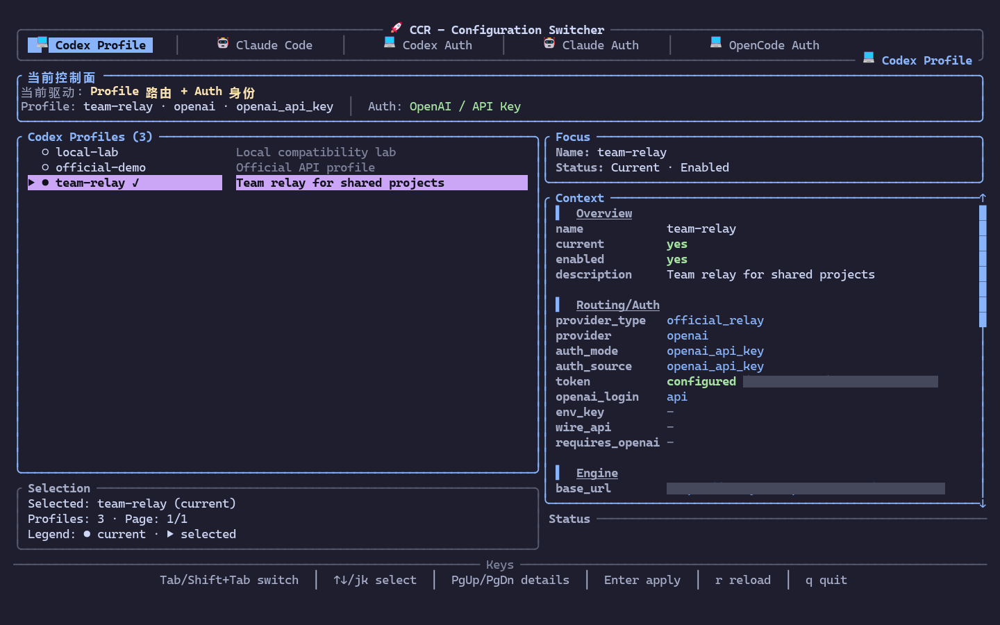
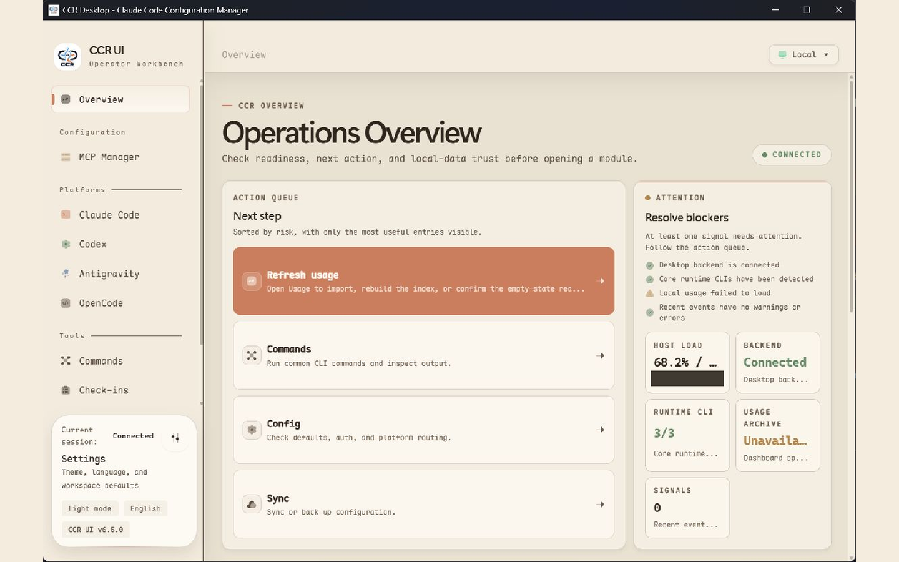
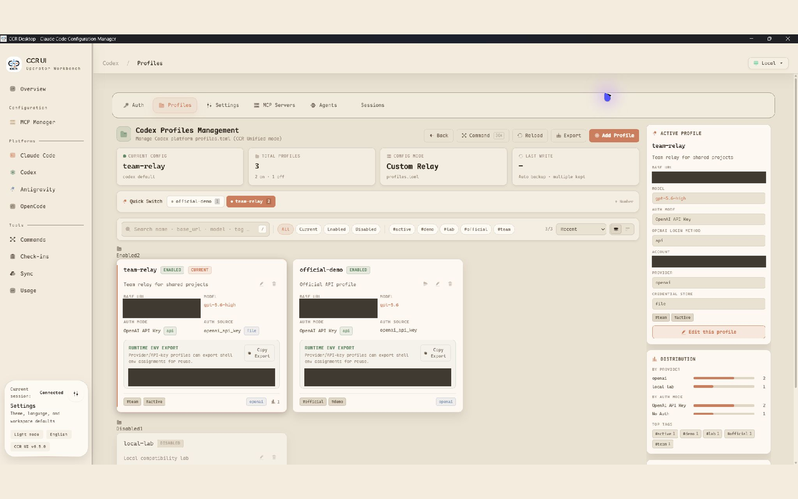

# CCR

**Rust 编写的 AI CLI 配置与运行时统一管理入口。**
以 CLI 为主线，围绕显式 Claude / Codex / Grok 运行时与 SQLite 配置库（`profiles.db`），配套终端 TUI 与完整 CCR UI。

## ✨ 核心特性

- **显式多运行时模型**：通过 `ccr current`（别名 `ccr status`、`ccr show`）直观查看各平台运行时与路由状态。
- **平台级 Profile 与 Auth 路由**：通过 `ccr <claude|codex|grok> profile ...` 与 `ccr <claude|codex|grok> auth ...` 显式管理各平台 SQLite 配置库（`~/.ccr/platforms/<platform>/profiles.db`）与官方登录账号。
- **安全凭据输入与配置交换**：通过 `--auth-token-stdin` / `--api-key-stdin` 管道传入密钥或用 `--env-key` 绑定环境变量名，支持 `profile open` 调用 `$EDITOR` 编辑投影，以及 `profile export --no-secrets` / `profile import`（`ExchangeV1` TOML）安全备份与迁移。
- **企业级安全**：支持原子写入、文件锁 (`fs4`)、脱敏审计历史与自动备份。
- **多端接口**：CLI、终端交互 TUI（`ccr`）与图形界面 CCR UI（`ccr ui`）。
- **智能同步与生态工具**：基于 WebDAV 的多目录同步、统一体检 `ccr doctor`、会话索引以及项目工作流初始化（`ccr project init`）。

## 界面预览

### TUI

终端界面将 Profile 切换、当前路由/认证上下文、所选配置详情和键盘操作集中在同一视图中。



### CCR UI Dashboard

Dashboard 在进入具体模块前集中展示桌面后端就绪状态、下一个建议操作、Runtime 可用性和平台信号。



### CCR UI Codex Profiles

Codex Profiles 在一个管理视图中整合快速切换、搜索与状态筛选、Profile 卡片、当前配置上下文和配置分布。



## 🚀 快速开始

```bash
# 初始化平台 Profile 配置库（~/.ccr/platforms/claude/profiles.db）
ccr claude profile init

# 通过 stdin 安全创建 Profile（避免在命令行参数中暴露明文密钥）
printf '%s' "$ANTHROPIC_AUTH_TOKEN" | ccr claude profile create work \
  --base-url https://api.example.com \
  --auth-token-stdin

# 查看、切换与校验
ccr claude profile list
ccr claude profile switch work
ccr current
ccr validate
ccr doctor
```

### 规范命令速查表

| 任务 | 规范命令 |
|---|---|
| 初始化平台配置库 | `ccr <claude\|codex\|grok> profile init` |
| 在 `$VISUAL` / `$EDITOR` 中编辑配置库 | `ccr <claude\|codex\|grok> profile open` |
| 切换 / 查看 / 退出 Profile 模式 | `ccr <claude\|codex\|grok> profile switch\|list\|current\|off` |
| 导出 / 导入 `ExchangeV1` TOML | `ccr <claude\|codex\|grok> profile export\|import` |
| 运行时总览与诊断体检 | `ccr current`、`ccr validate`、`ccr doctor`、`ccr platform list` |
| 初始化仓库工作流 | `ccr project init` |

> 从旧版本升级？请参阅 [迁移指南](docs/reference/migration.md) 查看旧命令与 `profiles.db` 存储模型的完整对照关系。

## 🔐 Runtime 命令

```bash
# Claude Code
ccr claude profile list
ccr claude profile switch work
ccr claude profile off

# Codex
ccr codex auth current
ccr codex profile list
ccr codex profile switch proxy
ccr codex profile off

# Grok
ccr grok profile init
ccr grok profile create xai --env-key XAI_API_KEY
ccr grok profile switch xai
ccr grok profile off

# 导出与导入 ExchangeV1 TOML
ccr claude profile export --no-secrets -o claude-profiles.toml
ccr claude profile import claude-profiles.toml --dry-run
```

## 🛠️ 开发指南

```bash
just build
just test
just ci
```
