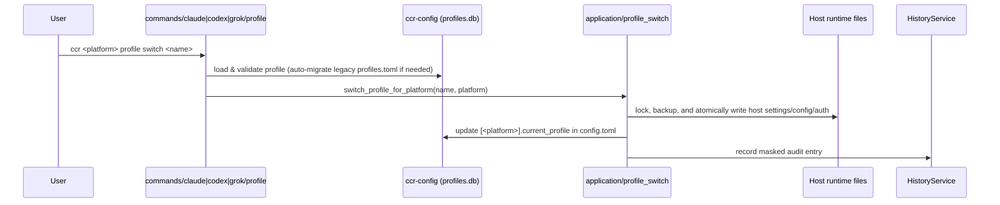

# Runtime Flows

This page records CCR 7.x's primary execution paths, focusing on explicit `claude` / `codex` / `grok` platform routing and SQLite `profiles.db` catalogs.

## 1. CLI Entry Dispatch

- `ccr` with no subcommand enters the interactive terminal TUI (`ccr codex` and `ccr grok auth` also open focused interactive views).
- `ccr current` (aliases: `ccr status`, `ccr show`) displays the runtime overview.
- Retired implicit top-level profile-switching shortcuts return migration guidance; see the [Migration Guide](../migration).

## 2. Platform-Scoped Profile Switching and Catalog Persistence

Key invariants:

- CCR never infers a target platform from a global `current_platform` field; the command path (`ccr <claude|codex|grok> profile ...`) chooses the platform explicitly.
- The authoritative live store is `~/.ccr/platforms/<platform>/profiles.db`; `profile open` projects a temporary TOML view into `$VISUAL` / `$EDITOR` and commits changes back to SQLite, while `profile export` and `profile import` exchange `ExchangeV1` TOML bundles.
- The active routing pointer in `~/.ccr/config.toml` is each platform entry's `current_profile` field.

## 3. `ccr current` Runtime Overview

`ccr current` (plus aliases `status` and `show`) aggregates:

- Claude Runtime status card
- Codex Runtime status card
- Registry target metadata under `--verbose`
- Structured JSON output under `--json` (`schema_version`, `generated_at`, `claude`, `codex`)

The top level no longer exposes the legacy `current_platform` field.
