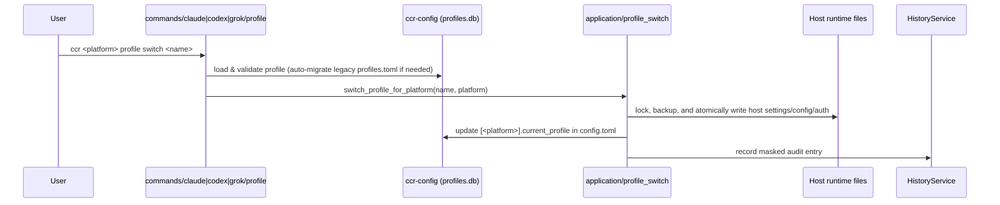

# 运行时流程

本页记录 CCR 7.x 最核心的运行路径，聚焦显式 `claude` / `codex` / `grok` 平台路由与 SQLite `profiles.db` 配置库。

## 1. CLI 入口分发

- `ccr` 无子命令时进入交互式终端 TUI（`ccr codex` 与 `ccr grok auth` 也提供对应聚焦页签入口）。
- `ccr current`（别名 `ccr status`、`ccr show`）展示当前运行时状态总览。
- 旧版隐式顶层切换入口与快捷方式已退场并返回迁移提示，详见 [迁移指南](../migration)。

## 2. 平台级 Profile 切换与配置库持久化

核心事实：

- 不再通过全局 `current_platform` 推断目标平台；目标平台由 `ccr <claude|codex|grok> profile ...` 命令路径显式决定。
- 权威活体存储是 `~/.ccr/platforms/<platform>/profiles.db`；`profile open` 通过临时 TOML 投影供 `$VISUAL` / `$EDITOR` 编辑并回写 SQLite，`profile export` 与 `profile import` 使用标准 `ExchangeV1` TOML 交换格式。
- 注册表路由指针保存在 `~/.ccr/config.toml` 中各平台条目的 `current_profile` 字段。

## 3. `ccr current` 运行时总览

`ccr current`（及别名 `status`、`show`）聚合：

- Claude Runtime 状态卡片
- Codex Runtime 状态卡片
- `--verbose` 下的平台注册表目标信息
- `--json` 下的结构化状态输出（`schema_version`、`generated_at`、`claude`、`codex`）

顶层不再输出旧版 `current_platform`。
